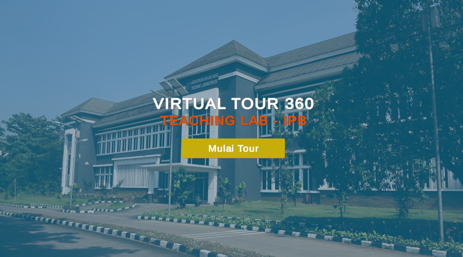
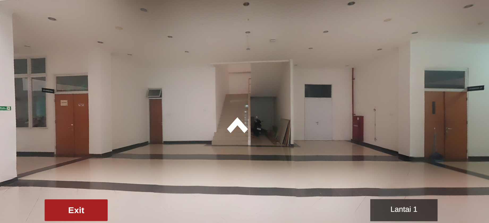
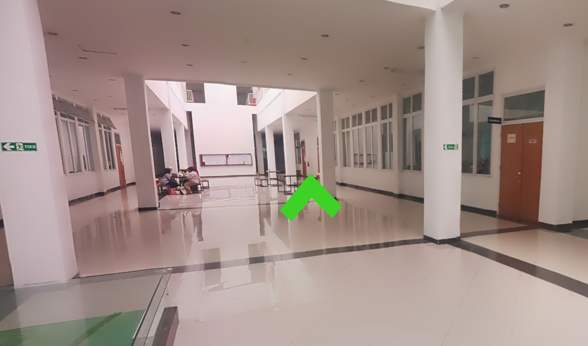

# Virtual Tour 360 Gedung Teaching Lab IPB
Project akhir matkul Grafik Komputer dan Visualisasi 2025. Project yang membuat virtual tour 360 selayaknya
google maps menggunakan Unity Engine versi `2022.3.61f1`. Virtual tour pada project ini difokuskan pada gedung Teaching Lab IPB.
Virtual Tour memiliki berbagai macam fungsionalitas seperti navigasi antar area, informasi ruangan, dan juga ambient suara.

## Hasil

     
Start Menu

     
Virtual Tour

     
Navigation

## Build
Tersedia build berupa program EXE yang bisa langsung dicoba.

## Anggota

|NIM        | Nama                   |
|-----------|------------------------|
|G6401231031| Qois Firosi            |
|G6401231052| Hannan Azhari Batubara |

## Reference
- Destined to Learn. (n.d.). <i>Virtual Tour with Unity</i> [[Playlist]]( https://youtube.com/playlist?list=PLGq_ojdWrNDuVufCMV81d6KmOUfJzc66l&si=nOlB80cjeDow-efN).
